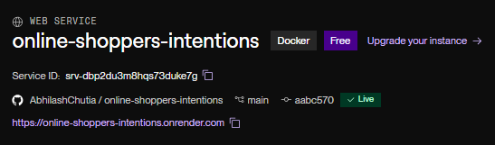
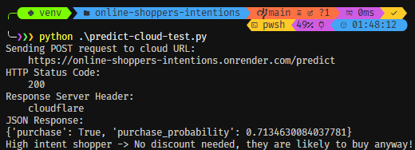

# Online Shoppers Purchasing Intention Prediction

## Project Overview

This project builds a machine learning pipeline and web service to predict whether an online browsing session will result in a transaction (`Revenue`). Accurately identifying high-intent shoppers in real time allows e-commerce platforms to optimize user experience and target retention strategies effectively.

---

## Dataset

The dataset used is the **Online Shoppers Purchasing Intention Dataset** from the UCI Machine Learning Repository, containing 12,330 user sessions across 18 features.

- **Numerical Features:** `administrative`, `administrative_duration`, `informational`, `informational_duration`, `productrelated`, `productrelated_duration`, `bouncerates`, `exitrates`, `pagevalues`, `specialday`

- **Categorical Features:** `month`, `operatingsystems`, `browser`, `region`, `traffictype`, `visitortype`, `weekend`

- **Target Variable:** `revenue` (binary: 0 for no purchase, 1 for purchase)

---

## Model Development & Validation

All exploratory data analysis, feature importance checks (correlation and mutual information), and model training are documented in `notebook.ipynb`.

Categorical identifier columns (`operatingsystems`, `browser`, `region`, `traffictype`) were converted to strings prior to vectorization to ensure proper one-hot encoding via scikit-learn's `DictVectorizer`. The dataset was split into 60% training, 20% validation, and 20% test sets.

### Model Performance Summary

- **Logistic Regression:** Best Validation AUC = `0.9014` (`C=0.01`)

- **Decision Tree Classifier:** Best Validation AUC = `0.9136` (`max_depth=6`, `min_samples_leaf=100`)

- **Random Forest Classifier:** Best Validation AUC = `~0.928+` (`max_depth=10`, `min_samples_leaf=5`)

- **XGBoost Classifier (Selected Model):** Validation AUC = `0.9229`, Final Test ROC AUC = `0.9295` (`eta=0.1`, `max_depth=4`, `min_child_weight=1`)

---

## Repository Structure

```text
├── data/
│   └── online_shoppers_intention.csv
├── screenshots/
│   └── terminal-cloud-test.png
├── .dockerignore
├── .gitignore
├── Dockerfile
├── README.md
├── model.bin
├── notebook.ipynb
├── predict-cloud-test.py
├── predict-test.py
├── predict.py
├── requirements.txt
└── train.py

```

---

## Local Execution Guide

### 1. Set Up Virtual Environment

```powershell
python -m venv venv
.\venv\Scripts\Activate.ps1
pip install -r requirements.txt

```

### 2. Train the Model

Runs data preparation, trains the tuned XGBoost model on the full training set, and exports artifacts to `model.bin`:

```powershell
python train.py

```

### 3. Start the Web Service

Launches the Flask application on port `9696`:

```powershell
python predict.py

```

### 4. Test the Endpoint

In a separate terminal with the virtual environment activated:

```powershell
python predict-test.py

```

---

## Docker Containerization

### 1. Build the Docker Image

```powershell
docker build -t shopper-prediction .

```

### 2. Run the Container

```powershell
docker run -it --rm -p 9696:9696 shopper-prediction

```

### 3. Test Containerized Service

While the container is running, execute the test script from your host terminal:

```powershell
python predict-test.py

```

---

## Visual Verification & Screenshots

### Render Cloud Deployment



### Terminal Prediction Output - Cloud


